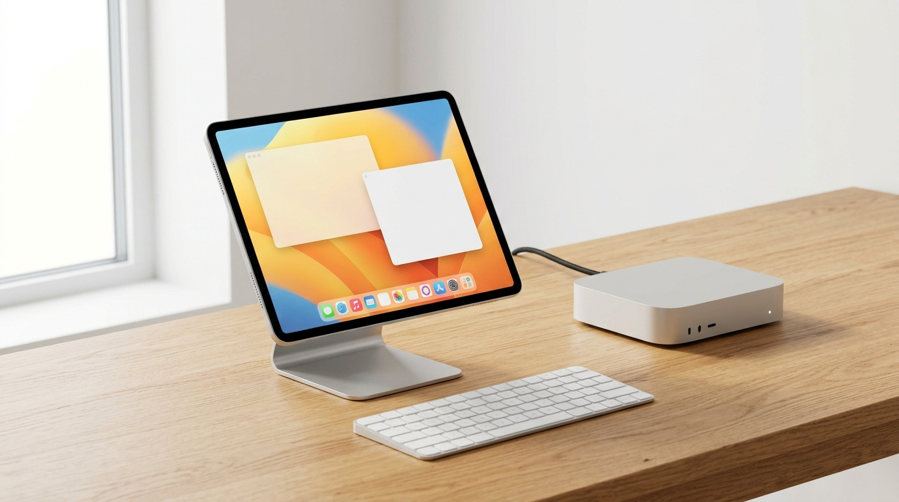

# Afar · Mac 端

<p align="center">
  <a href="https://apps.apple.com/app/id6834720178"></a>
  <a href="https://github.com/dm-mdz/afar/releases/latest"></a>
  <a href="LICENSE"></a>
  <a href="LICENSE-PROTOCOL-MIT"></a>
</p>

<p align="center">
  
</p>

<p align="center">
  <a href="#中文">中文</a> · <a href="#english">English</a> · <a href="https://apps.apple.com/app/id6834720178">iPad App (App Store)</a> · <a href="https://github.com/dm-mdz/afar/releases/latest">Download Mac DMG</a>
</p>

---

## 中文

**iPad 点一下，就成为没接显示器的 Mac（比如家里的 Mac mini）的原生随航触控屏。**

<p align="center">
  
</p>

这个仓库是 Afar 的 **Mac 端常驻程序**（`0.5.0` 起已全面重构为纯 C11 + 轻量原生 Objective-C，`1.3 MB` 已公证 DMG、纯后台仅 `~10 MB` 内存）和 **Mac 与 iPad 之间的通信协议**。配套的 iPad App 免费发布于 [App Store](https://apps.apple.com/app/id6834720178)，不在本仓库。

**下载**：Mac 端到本仓库的 [Releases](../../releases) 页下载已公证的 `Afar-<版本>.dmg`；iPad 端到 [App Store](https://apps.apple.com/app/id6834720178) 免费下载。

### 能做什么
- **没接显示器也能用**：建一块虚拟屏、防休眠，Mac mini 不接显示器也有桌面；菜单栏支持「防拔线（保留虚拟屏）」开关。
- **随航自动连接**：开机、点卡片时自动连，没连上会再试 2 次；随航中途断了（iPad 锁屏、信号不好），iPad 回到 Afar 时自动连回；从 Afar 主动断开后不会被自动连回（跨重启有效），直到你再点连接。
- **显示大小三档**：更大文字 / 默认 / 更多空间，按每台 iPad 的屏幕计算。
- **菜单栏与「设置 Afar」向导**：状态、立即连接 / 断开 iPad、「开机自动连接」与「防拔线」开关、配对新 iPad；引导配置防火墙放行、断电自启、文件保险箱和自动登录，列出并可逐台取消配对。
- **给 iPad App 的控制接口**：配对、状态、连接 / 断开、回到 Mac 桌面、重启 Mac、改名称和显示大小、保存登录密码。
- **蓝牙键盘交接**：用随航时把你选的蓝牙键盘接到 Mac，用完还给 iPad（经典蓝牙键盘，不支持低功耗蓝牙键盘）。
- **插回显示器恢复分辨率 & 远程桌面友好**：iPad 未显示时保留远程桌面清晰 HiDPI 尺寸，远程软件切低清时自动拉回清晰，支持 `extra_sizes` 追加分辨率。
- **老版本无损升级**：从 `0.4.x` 升级时自动迁移 `config.toml` → `config.json`，沿用原有 TLS 证书与已配对设备，免重新配对。
- **原生中英双语（0.5.1 新增）**：Mac 菜单栏、设置向导与 iPad 端自动跟随系统语言，并在菜单栏和界面角落提供一键 `中 / EN` 切换。

### 设备要求
| | 要求 |
|---|---|
| Mac | Apple 芯片，macOS 27 及以上 |
| iPad | iPadOS 27 及以上（随航手指直接点击需 macOS 27 + iPadOS 27） |
| 随航本身的要求 | 同一个 Apple 账户（开双重认证）；蓝牙、Wi-Fi、接力打开；相距 10 米内；同一局域网 |

### 编译和安装
需要 Xcode 命令行工具（`clang`、`make`）、`cmake` 与 `python3`（无 Rust 依赖，第三方库 `libuv / mbedTLS / llhttp / libdm` 已随仓内嵌）。

```bash
python3 build.py check        # 静态门禁检查
python3 build.py release      # 编译 Release 二进制
./script/make-app.sh          # 生成 build/dist/Afar.app 和 Afar-<版本>.dmg
```

打开 dmg，把 **Afar** 拖进「应用程序」，再从「应用程序」里打开：自动装好开机自启，并弹出「设置 Afar」向导。

- 无 Developer ID 时为临时签名（ad-hoc），首次打开需在「系统设置 › 隐私与安全性」点「仍要打开」。
- 有 Developer ID 证书时：`./script/make-app.sh --sign "Developer ID Application: …" --notarize <keychain-profile>`。签名证书与公证凭据**只在打包时传入，不进入仓库**。
- 配置文件：`~/Library/Application Support/Afar/config.json`（端口默认 `47911`，支持 `ipad_name`、`auto_connect`、`scale`、`ipad_pixels`、`mirror`、`port`、`extra_sizes`）；日志：`~/Library/Application Support/Afar/agent.log`。
- 命令行：`/Applications/Afar.app/Contents/MacOS/afar-agent run | install | uninstall | pair-code | ipads | connect [名称] | disconnect | displays | bt-dump | setup | status | config`。

### 安全设计
- 只在局域网工作，全程 TLS 1.3 / 1.2 加密（Mac 端自签证书），通过 Bonjour 广播 `_afar._tcp`。
- **平时不接受配对**：仅在菜单栏点「配对新 iPad…」、向导配对页或执行 `pair-code` 后的 10 分钟内开放；配对成功、手动停止、关窗或超时立即关闭。
- **配对协议**：Mac 显示 6 位配对码，双方基于 **EC-JPAKE** 协商会话密钥（配对码不在线路明文传输、抗离线暴力破解），并核对双方所见证书指纹防中间人；单码最多错 5 次，触发指数退避锁定（1、2、4、8…分钟，最长 1 小时）。
- 配对后 iPad 钉住证书并获得令牌，Mac 仅存令牌哈希；登录密码先经系统校验再存入 macOS 钥匙串（连错 5 次锁 1 分钟）。

### 关于私有接口
随航连接、虚拟屏与部分显示模式切换使用了 Apple 未公开接口，集中隔离在 `src/plat/private/`。系统升级后可能受影响；Mac 端因此通过 dmg 分发，不上架 Mac App Store。

### 许可证与隐私
Copyright (C) 2026 DM

- **Mac Agent 源码**：[GPL-3.0-or-later](LICENSE)。修改后再发布必须同样开源。
- **局域网通信协议与 JSON 契约**：[MIT](LICENSE-PROTOCOL-MIT)，可自由用于任何兼容客户端。
- **商标**：「Afar」名称与图标不在上述许可范围内，基于本仓库修改后再发布请更换名称与图标。
- **隐私政策**：见 [PRIVACY.md](PRIVACY.md)；**安全漏洞报告**：请勿开公开 Issue，做法见 [SECURITY.md](SECURITY.md)。

本软件按「现状」提供，不附带任何担保。

---

## English

**Tap once on your iPad and it becomes the touchscreen of a headless Mac — such as a Mac mini with no monitor attached.**

This repository contains Afar's **Mac agent** (rebuilt in pure C11 + thin native Objective-C as of `0.5.0`) and the **LAN control protocol**. The companion iPad app is distributed separately and is not part of this repository.

**Download**: get `Afar-<version>.dmg` from the [Releases](../../releases) page.

### Highlights
- **Headless virtual display & keep-awake**: HiDPI virtual display with three per-iPad display scales, remote-desktop HiDPI preservation (`extra_sizes`), external monitor resolution restore, and optional "keep virtual display on unplug".
- **Smart Sidecar lifecycle**: auto-connect on boot and tap, automatic reconnect when returning to the iPad app after link drops, and persistent manual disconnect state across restarts.
- **Bluetooth keyboard hand-over**: moves a classic Bluetooth keyboard to the Mac while Sidecar is active and hands it back afterwards.
- **Seamless upgrade from 0.4.x**: automatically migrates `config.toml` to `config.json` while keeping existing TLS certificates and paired devices intact.
- **Bilingual English & Chinese UI (new in 0.5.1)**: auto-detects macOS / iPadOS system language with a built-in one-click `EN / 中文` switcher in the menu bar and setup window.

### Requirements & Build
Requires Apple silicon Mac (macOS 27+), iPad (iPadOS 27+), Apple Command Line Tools, `cmake`, and `python3` (all C dependencies are vendored under `public/`).

```bash
python3 build.py check
python3 build.py release
./script/make-app.sh
```

- Signing & notarization: `./script/make-app.sh --sign "Developer ID Application: …" --notarize <keychain-profile>` (credentials are never stored in the repo).
- Config: `~/Library/Application Support/Afar/config.json` (default port `47911`); Log: `~/Library/Application Support/Afar/agent.log`.

### Security & Private APIs
- LAN-only TLS 1.3/1.2 with self-signed cert pinning, Bonjour `_afar._tcp`, closed-by-default 10-minute pairing window, EC-JPAKE key agreement with certificate fingerprint confirmation, rate limiting + exponential backoff, and macOS Keychain password storage.
- Undocumented Apple APIs for Sidecar and virtual displays are isolated under `src/plat/private/`.

### License, Privacy & Security
Copyright (C) 2026 DM

- **Mac Agent**: [GPL-3.0-or-later](LICENSE)
- **Wire Protocol**: [MIT](LICENSE-PROTOCOL-MIT)
- **Trademark**: the name "Afar" and its icon are excluded from these licenses.
- **Privacy Policy**: [PRIVACY.md](PRIVACY.md) · **Security**: [SECURITY.md](SECURITY.md)
