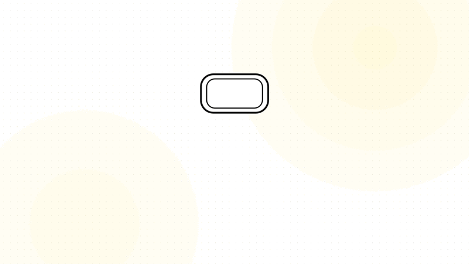

# Afar · Mac 端（v0.6.0）

<p align="center">
  <a href="https://apps.apple.com/app/id6834720178"></a>
  <a href="https://github.com/dm-mdz/afar/releases/latest"></a>
  <a href="LICENSE"></a>
  <a href="public/proto/af_direct_proto/LICENSE"></a>
</p>

<p align="center">
  
</p>

<p align="center">
  <a href="#中文">中文</a> · <a href="#english">English</a> · <a href="https://apps.apple.com/app/id6834720178">iPad App (App Store)</a> · <a href="https://github.com/dm-mdz/afar/releases/latest">Download Mac DMG</a>
</p>

---

## 中文

**iPad 点一下，就成为没接显示器的 Mac（比如家里的 Mac mini）的双模触控屏：日常低延迟直连 + 原生随航画板。**

<p align="center">
  
</p>

这个仓库是 Afar `0.6.0` 的 **Mac 端常驻程序**（纯 C11 + 轻量原生 Objective-C，小体积已公证 DMG、极低内存占用）和 **MIT 协议开源的通信与二进制线协议库**（`public/proto/af_direct_proto/`）。配套的 iPad App 免费发布于 [App Store](https://apps.apple.com/app/id6834720178)，不在本仓库。

**下载**：Mac 端到本仓库的 [Releases](../../releases) 页下载已公证的 `Afar-0.6.0.dmg`；iPad 端到 [App Store](https://apps.apple.com/app/id6834720178) 免费下载。

### 双模式与核心特性
- **「日常 / Daily」直连模式（0.6.0 新增）**：
  - **低延迟 HEVC 硬件串流**：基于 Apple `ScreenCaptureKit` + `VideoToolbox` 硬件编码，支持动态码率自适应、静帧高清锐化与零云端局域网加密直传（亦支持 USB-C 有线直连）。
  - **零蓝牙全输入并发**：直接透传连接在 iPad 上的物理键盘（含 UTF-8 输入法文本）、鼠标、妙控板/触控手势与 Apple Pencil，无需交接蓝牙键盘，也**不受随航同一 Apple 账户与 10 米距离限制**。
- **「画板 / Pro Draw」模式（原生 Sidecar）**：
  - 一键拉起或热切换至 Apple 原生随航，保留原厂 Apple Pencil 压感与专业绘图手感；支持开机/点击自动连接、断连重连及跨重启保留手动断开状态。
  - 保留经典蓝牙键盘自动交接能力（仅用于画板模式）。
- **没接显示器也能用**：内置 HiDPI 虚拟屏与防休眠，支持三档显示大小（更大文字 / 默认 / 更多空间）、远程桌面高清保护（`extra_sizes`）、插回外接显示器自动恢复分辨率，以及菜单栏「防拔线（保留虚拟屏）」开关。
- **菜单栏、设置向导与中英双语**：状态展示、模式一键断开/切换、配对新 iPad、引导系统设置，并自动跟随系统语言与提供一键 `中 / EN` 切换。
- **老版本无损升级**：沿用既有 `config.json` / `config.toml` 自动迁移、TLS 证书与已配对设备，免重新配对。

### macOS 权限说明（按需最小授权）
| 权限 | 适用模式 | 说明 |
|---|---|---|
| 屏幕录制 | **仅日常模式** | 通过 ScreenCaptureKit 捕获虚拟屏画面并经局域网 ChaCha20-Poly1305 AEAD 加密直传至你的 iPad，**零云端中转、零落盘录像**。**仅用画板模式可不授权。** |
| 辅助功能 | **仅日常模式** | 仅在直连会话活跃时注入键鼠、触控与 Apple Pencil 事件；会话结束或断线立即释放全部按键（系统密码框/SecureInput 期间于 iPad 端提示安全输入态，绝不记录或缓存任何按键内容）。**仅用画板模式可不授权。** |
| 蓝牙 | **仅画板模式** | 仅用于画板（Sidecar）模式的经典蓝牙键盘交接；日常模式完全不需要蓝牙。 |
| 本地网络 / 系统事件 | 双模式 | 用于局域网 Bonjour 发现与配对，以及设置向导与远程重启。 |

### 设备要求
| | 要求 |
|---|---|
| Mac | Apple 芯片，macOS 27 及以上 |
| iPad | iPadOS 27 及以上 |
| 网络与随航 | 同一局域网（或 USB-C 直连）；仅「画板」模式额外要求随航自身条件（同一 Apple 账户、蓝牙/Wi-Fi/接力开启、10 米内） |

### 编译和安装
需要 Xcode 命令行工具（`clang`、`make`）、`cmake` 与 `python3`（无 Rust 依赖，全部 C 依赖 `libuv / mbedTLS / llhttp / yyjson / monocypher / libdm` 及 MIT 协议库 `af_direct_proto` 均已随仓内嵌）。

```bash
python3 build.py check          # L0 静态门禁检查
python3 build.py build release  # 编译 Release 二进制
./script/make-app.sh            # 生成 build/dist/Afar.app 和 Afar-0.6.0.dmg
```

打开 dmg，把 **Afar** 拖进「应用程序」，再从「应用程序」里打开：自动装好开机自启，并弹出「设置 Afar」向导。

- 无 Developer ID 时为临时签名（ad-hoc），首次打开需在「系统设置 › 隐私与安全性」点「仍要打开」。
- 有 Developer ID 证书时：`./script/make-app.sh --sign "Developer ID Application: …" --notarize <keychain-profile>`。签名证书与公证凭据**只在打包时传入，不进入仓库**。
- 配置文件：`~/Library/Application Support/Afar/config.json`（默认端口 `47911`）；日志：`~/Library/Application Support/Afar/agent.log`。
- 命令行：`/Applications/Afar.app/Contents/MacOS/afar-agent run | install | uninstall | pair-code | ipads | connect [名称] | disconnect | displays | bt-dump | setup | status | config`。

### MIT 独立协议库（`public/proto/af_direct_proto/`）
- **目录内容**：`public/proto/af_direct_proto/`（含独立 [MIT LICENSE](public/proto/af_direct_proto/LICENSE)、`af_direct_proto.h`、`af_direct_proto.c`、`af_vid_udp.h`、`af_vid_udp.c`、`af_direct_proto.mk`）。
- **零外部依赖**：纯 C11 编写，不依赖 OS API、不依赖 `libdm` 或加密库，完整定义并编解码日常模式的 24B 视频帧头、HEVC `CONFIG`/HVCC 校验、UDP 视频分片与交错 XOR FEC、32B UDP 输入明文头及离散键鼠/触控/Pencil/UTF-8 事件 TLV，可供任何兼容客户端按 MIT 协议直接集成。

### 安全设计
- **局域网直连、零云端、零落盘录像**；默认关闭配对，仅主动打开后的 10 分钟内通过 **EC-JPAKE** + 双方证书 SHA-256 指纹核验完成配对，错 5 次触发指数退避锁定。
- **HTTPS 控制面**：独立线程 mbedTLS TLS 1.3 + 自签叶证书 SHA-256 钉扎 + 敏感 JSON/缓冲区释放前安全擦零。
- **日常模式双通道独立加密**：UDP 视频流（ChaCha20-Poly1305 AEAD + 交错 XOR FEC + 加密 `HELLO`/`KEEPALIVE`/`BYE` 握手与单客锁定 + 64-bit 滑动防重放窗）与 UDP 控制/输入流（ChaCha20-Poly1305 AEAD + 16B 外层头 AAD + 12B 方向隔离 Nonce + 64-bit 滑动防重放窗）；每次会话经 HKDF-SHA256 独立派生三把子密钥，严禁跨重连复用。
- **输入安全**：周期检测 Apple SecureInput 状态并在 iPad 端展示安全输入提示（绝不记录、缓存或上传任何按键内容）；断线、退后台、取消配对或看门狗超时自动触发 `RELEASE_ALL` 释放全部按键状态。
- 完整说明见 [SECURITY.md](SECURITY.md) 与 [PRIVACY.md](PRIVACY.md)。

### 关于私有接口
随航连接、虚拟屏与部分显示模式切换使用了 Apple 未公开接口，集中隔离在 `src/plat/private/`。系统升级后可能受影响；Mac 端因此通过 dmg 分发，不上架 Mac App Store。

### 许可证与隐私
Copyright (C) 2026 DM

- **Mac Agent 源码**：[GPL-3.0-or-later](LICENSE)。修改后再发布必须同样开源。
- **直连二进制线协议库（`public/proto/af_direct_proto/`）与 HTTPS JSON 契约**：[MIT](public/proto/af_direct_proto/LICENSE) / [LICENSE-PROTOCOL-MIT](LICENSE-PROTOCOL-MIT)，可自由用于任何兼容客户端。
- **商标**：「Afar」名称与图标不在上述许可范围内，基于本仓库修改后再发布请更换名称与图标。
- **隐私政策**：见 [PRIVACY.md](PRIVACY.md)；**安全漏洞报告**：请勿开公开 Issue，做法见 [SECURITY.md](SECURITY.md)。

本软件按「现状」提供，不附带任何担保。

---

## English

**Tap once on your iPad and it becomes a dual-mode display for your headless Mac — combining low-latency HEVC direct streaming for everyday work with native Apple Sidecar for drawing.**

This repository contains Afar `0.6.0`'s **Mac agent** (pure C11 + thin native Objective-C) and its **MIT-licensed wire protocol library** (`public/proto/af_direct_proto/`). The companion iPad app is distributed free on the [App Store](https://apps.apple.com/app/id6834720178) and is not part of this repository.

**Download**: get `Afar-0.6.0.dmg` from the [Releases](../../releases) page.

### Dual Modes & Highlights
- **"Daily" Direct Mode (new in 0.6.0)**:
  - **Low-latency HEVC hardware streaming**: powered by Apple `ScreenCaptureKit` + `VideoToolbox` with adaptive bitrate, idle-frame sharpening, and encrypted peer-to-peer LAN (or USB-C) streaming.
  - **Zero-Bluetooth full concurrent input**: forwards physical keyboard (including UTF-8 IME text), mouse, trackpad/touch gestures, and Apple Pencil simultaneously—no Bluetooth keyboard hand-over and no same-Apple-Account Sidecar limitation.
- **"Pro Draw" Mode (Native Sidecar)**:
  - One-tap native Sidecar launch and hot switching from Daily mode, keeping native Apple Pencil pressure/hover, smart auto-reconnect, persistent manual disconnect state, and optional classic Bluetooth keyboard hand-over.
- **Headless Virtual Display & Bilingual UI**: HiDPI virtual display with three per-iPad scales, remote-desktop HiDPI preservation (`extra_sizes`), external display resolution restore, optional "keep virtual display on unplug", seamless upgrades, and built-in `EN / 中文` switching.

### macOS Permissions (Least Privilege)
- **Screen Recording & Accessibility**: required **only for Daily mode** (ScreenCaptureKit peer-to-peer encrypted streaming with zero cloud relay and zero disk recording; input injection active only during a direct session). **If you only use Pro Draw (Sidecar), you do not need to grant either permission.**
- **Bluetooth**: used **only for Pro Draw mode** (classic Bluetooth keyboard hand-over). Daily mode does not use Bluetooth.
- **Local Network & Apple Events**: used for LAN Bonjour discovery/pairing and setup assistance.

### Standalone MIT Protocol Library (`public/proto/af_direct_proto/`)
`public/proto/af_direct_proto/` is a zero-dependency pure C11 library (`LICENSE`, `af_direct_proto.h`, `af_direct_proto.c`, `af_vid_udp.h`, `af_vid_udp.c`, `af_direct_proto.mk`) licensed under **MIT**—no OS APIs, no `libdm`, and no crypto dependencies. It implements framing and validation for the 24B video headers, HEVC `CONFIG`/HVCC payloads, UDP video chunking with interleaved XOR FEC, 32B UDP input headers, and discrete input TLVs so third-party clients can integrate it directly.

### Requirements & Build
Requires Apple silicon Mac (macOS 27+), iPad (iPadOS 27+), Apple Command Line Tools, `cmake`, and `python3` (all C dependencies—`libuv`, `mbedTLS`, `llhttp`, `yyjson`, `monocypher`, `libdm`, and `af_direct_proto`—are vendored under `public/`).

```bash
python3 build.py check
python3 build.py build release
./script/make-app.sh
```

- Signing & notarization: `./script/make-app.sh --sign "Developer ID Application: …" --notarize <keychain-profile>` (credentials are never stored in the repo).
- Config: `~/Library/Application Support/Afar/config.json` (default port `47911`); Log: `~/Library/Application Support/Afar/agent.log`.

### Security & Private APIs
- **HTTPS Control Plane**: isolated `T_https` thread running mbedTLS TLS 1.3 with self-signed leaf cert SHA-256 pinning, EC-JPAKE 10-minute opt-in pairing with rate limiting + exponential backoff, and zero-on-free handling of sensitive JSON/HTTP buffers.
- **Direct Mode Encryption**: per-session HKDF-SHA256 subkey derivation (no key reuse across reconnects); both the UDP video stream (interleaved XOR FEC + encrypted `HELLO`/`KEEPALIVE`/`BYE` single-peer lock) and UDP control/input channel are encrypted with ChaCha20-Poly1305 AEAD + 16B outer header AAD + 12B direction-isolated Nonce + 64-bit sliding anti-replay window.
- **Input Safety**: monitors macOS Apple SecureInput state and displays a lightweight indicator on iPad during secure password entry (zero keystroke logging or caching), plus `RELEASE_ALL` on backgrounding, disconnect, revocation, or 1.5s watchdog timeout.
- Undocumented Apple APIs for Sidecar and virtual displays are isolated under `src/plat/private/`.

### License, Privacy & Security
Copyright (C) 2026 DM

- **Mac Agent**: [GPL-3.0-or-later](LICENSE)
- **Wire Protocol & `public/proto/af_direct_proto/`**: [MIT](public/proto/af_direct_proto/LICENSE) / [LICENSE-PROTOCOL-MIT](LICENSE-PROTOCOL-MIT)
- **Trademark**: the name "Afar" and its icon are excluded from these licenses.
- **Privacy Policy**: [PRIVACY.md](PRIVACY.md) · **Security**: [SECURITY.md](SECURITY.md)
